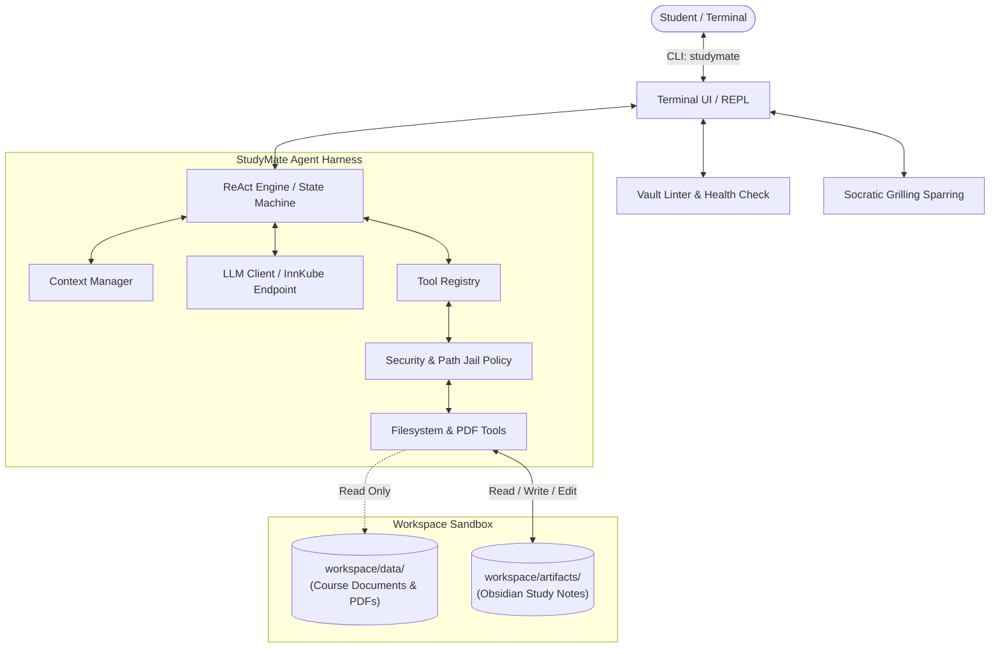

# StudyMate 🎓

StudyMate is an autonomous AI agent harness built from scratch in Python 3.12 for the *AI Engineering Lab (SoSe 2026)* at the University of Passau. It enables university students to prepare for courses and exams by autonomously analyzing source materials and compiling structured, interconnected Obsidian knowledge bases and study artifacts (flashcards, mind maps, concept glossaries, and Socratic sparring sessions).

---

## Overview and Features

StudyMate operates directly from the terminal via an interactive CLI (`studymate`). Built on the **ReAct (Reason + Act)** paradigm, it functions as an autonomous study assistant:

- **Source Material Ingestion**: Autonomously inspects and extracts text from lecture slides (`.txt`, `.md`, `.pdf`), research papers, exercise sheets, and textbook notes stored in `workspace/data/`.
- **Atomic Obsidian Knowledge Base**: Generates interconnected study notes in `workspace/artifacts/`:
  - **Concept Notes**: Slugs with standardized YAML frontmatter, Core Intuition, Formal Definitions, Worked Examples, Pitfalls, and `[[wikilinks]]`.
  - **Lecture Summaries**: Synthesized high-level lecture overviews with bidirectional links to atomic concepts.
  - **Flashcards**: Markdown-formatted active recall question-answer decks (compatible with Anki and Obsidian).
- **Vault Health Check (Linter)**: Autonomous verification of the knowledge base graph via `/lint`:
  - Detects broken `[[wikilinks]]` referencing non-existent notes.
  - Identifies orphan pages with zero inbound links.
  - Aggregates and surfaces pending open questions.
- **Socratic Grilling (`/grill <topic>`)**: Interactive active recall sparring partner enforcing German academic rigor across escalating difficulty levels (Recall $\to$ Application $\to$ Edge Case).
- **Strict Sandbox & Security Boundaries**:
  - `workspace/data/`: **Read-Only** (the immutable source of truth and knowledge base).
  - `workspace/artifacts/`: **Read, Write, and Edit** (where generated study artifacts reside).
  - **No Deletion Guarantee**: The agent is strictly prohibited from deleting any files or directories across all paths.
  - **Jail Containment**: All file operations are sandboxed strictly within `./workspace/`; directory traversal outside this boundary is rejected.
- **MCP Research and Obsidian Tools**:
  - `research_topic` performs Perplexity-style multi-source research: it aggregates
    deduplicated sources, fetches relevant same-site pages, and returns cited page
    evidence. Set `depth=0` for search-only results or provide `domains` to search
    selected websites independently.
  - `obsidian_list_notes`, `obsidian_read_note`, `obsidian_search_notes`, `obsidian_write_note`,
    `obsidian_edit_note`, and `obsidian_append_note` support filesystem-first note-taking,
    including anchored edits and `[[wikilinks]]`, without deletion.

---

## Architecture



---

## Project Structure

```text
project/group-11/
├── config/
│   ├── config.yaml             # Model, agent parameters, and tool sandbox settings
│   └── soul.md                 # Agent persona, directives, and output conventions
├── src/
│   └── study_agent/
│       ├── cli/                # Terminal interactive REPL (studymate)
│       ├── config/             # Configuration schemas and YAML/env loader
│       ├── core/               # ReAct loop, context manager, and state machine
│       ├── llm/                # InnKube (OpenAI-compatible) client and test mocks
│       ├── tools/              # Tool registry, filesystem/PDF tools, and MCP capabilities
│       │   └── mcp/            # Internet research + Obsidian MCP server and adapters
│       ├── study/              # Obsidian templates, VaultLinter, and SocraticGriller
│       ├── memory/             # Persistent long-term memory (Week 2)
│       ├── observability/      # Prometheus telemetry & lifecycle hooks (Week 3)
│       ├── security/           # Multi-tier permission management (Week 3)
│       └── subagents/          # Specialized sub-agent coordination (Week 3)
├── tests/
│   ├── unit/                   # Unit tests (config, context, LLM, tools, engine, linter)
│   └── e2e/                    # End-to-end benchmark & study workflow tests
├── workspace/
│   ├── data/                   # Input study materials (Read-Only)
│   └── artifacts/              # Generated study artifacts (Read/Write/Edit)
├── compose.yaml                # Docker Compose multi-platform launcher
├── Dockerfile                  # Container definition (python:3.12-slim-bookworm)
├── pyproject.toml              # Modern Python packaging & CLI entrypoint
└── requirements.txt            # Locked project dependencies
```

---

## Getting Started

### 1. Prerequisites
- Python 3.12+
- Docker or Podman (for containerized execution)

### 2. Local Setup
```bash
# Clone the repository and navigate to the project directory
git clone <repository-url>
cd project/group-11

# Create and activate a Python 3.12 virtual environment
python -m venv venv

# On Windows (PowerShell):
.\venv\Scripts\Activate.ps1

# On Linux/macOS:
source venv/bin/activate

# Install dependencies and package in editable mode
pip install -r requirements.txt
pip install -e .
```

### 3. Environment Configuration
Create a `.env` file from the provided template and configure your InnKube API token:
```bash
cp .env.example .env
```

Edit `.env`:
```env
INNKUBE_API_KEY=your_innkube_token_here
```

### 4. Add Your Study Materials
`workspace/data/` and `workspace/artifacts/` aren't tracked in git (they start empty), so on a fresh
clone you need to create them yourself before running StudyMate locally (the Docker image creates them
automatically at build time):
```bash
mkdir -p workspace/data workspace/artifacts
```
Then drop your lecture slides, notes, or PDFs into `workspace/data/` — this is the **read-only** source
StudyMate ingests from. Generated notes will be written to `workspace/artifacts/`.

### 5. Running StudyMate
Once installed, launch the interactive agent terminal using:
```bash
studymate
```

The MCP server can be launched over stdio for an MCP host. Set `OBSIDIAN_VAULT_PATH`
to override the vault directory; it defaults to the project `workspace/` directory:

```powershell
$env:OBSIDIAN_VAULT_PATH = "C:\path\to\your\vault"
python -m study_agent.tools.mcp.server
```

#### Interactive Commands in REPL:
- `/help` — Display command guide
- `/ingest [path]` — Ingest source files (defaults to `workspace/data/`) into Obsidian concept notes + lecture summary
- `/lint [path]` — Run knowledge graph health check on study artifacts
- `/grill <topic>` — Launch an interactive Socratic sparring session on a topic
- `/templates` — Display standard Obsidian markdown templates
- `/threads` — Browse previous chat threads (↑/↓ + Enter, paged)
- `/thread <#|id|name>` — Enter/continue a previous thread (transcript restored)
- `/new [name]` — Start a new thread (default on first message)
- `/archive-this` — Archive the current thread (tombstone, no delete)
- `/archive-all` — Archive ALL threads (asks for confirmation)
- `/compact` — Summarize history into a checkpoint now (while staying on the same thread)
- `/clear` — Reset in-memory history (thread history stays saved)
- `/config` — View active runtime settings
- `/exit, /quit` — Quit StudyMate

#### Long-Term Memory:
Chat threads persist across restarts in `workspace/artifacts/memory/memory.db`
(SQLite). Durable facts (preferences, struggles) are stored via the agent's
`memory_store` tool and retrieved hybrid: exact keyword matches first, then
meaning-similar hits via `sqlite-vector` cosine search, reordered by the
InnKube reranker (`memory_recall`). One API key covers chat, embeddings,
and rerank (granted per model server-side). Top recent facts auto-inject
at session start. All memory writes are append-only — nothing is ever deleted.

#### Procedural Memory:
Reusable routines live as markdown bundles in `workspace/artifacts/procedures/`
(committed, reviewable). Each has triggers, scope, ordered steps, rationale,
and a `draft/approved/archived` status. Matching approved routines inject
automatically before the agent acts; drafts are surfaced for confirmation,
never followed silently. Agent-distilled routines start as drafts for human
approval; editing a file supersedes it (git is the version log).

#### Context Compaction:
Long sessions compact automatically at ~80% of the active model's window
(resolved per model via `compaction.context_windows`, gateway discovery,
or a conservative default — see `/config`), or on demand with `/compact`.
Old tool outputs blank first (free); older turns then fold into one summary
in the same thread. Nothing is deleted: the summary persists to the thread.

---

## Usage Example

A typical session: point the agent at your lecture material, let it build the knowledge base, then
check the vault's health.

```
$ studymate

  🎓 Welcome to StudyMate
  Model: qwen-agentworld-35b-a3b  Endpoint: https://llms.innkube.fim.uni-passau.de
  Type your question or study goal. Type /help for commands or /exit to quit.

student > /ingest workspace/data
📥 Ingesting source material from 'workspace/data'...

  ⚙ Action: list_files {'path': 'workspace/data'}
  ⚙ Action: read_file {'path': 'workspace/data/lecture01.pdf'}
  ⚙ Action: write_file {'path': 'workspace/artifacts/lecture-lecture01.md', ...}
  ⚙ Action: write_file {'path': 'workspace/artifacts/concept-dynamic-programming.md', ...}

I've ingested lecture01.pdf and created lecture-lecture01.md, cross-linked to
concept-dynamic-programming.md via [[wikilinks]].

student > /lint
Vault Health Report: workspace/artifacts
  Total Markdown Notes: 2   Broken Wikilinks: 0 (Clean)   Orphan Pages: 0

student > /grill Dynamic Programming
🥊 Launching Socratic Grilling Session on 'Dynamic Programming'...
Define the optimal substructure property. Be precise — no hand-waving.

student > /exit
Goodbye and happy studying! 🎓
```

---

## Testing

Execute the automated test suite with pytest (109 unit and E2E tests):
```bash
# Run all tests
pytest

# Or via uv:
uv run --with pytest --with pytest-mock pytest
```

---

## Containerization (Docker)

To execute StudyMate inside an isolated Debian-based container (`python:3.12-slim-bookworm`):

### Option A: Using Docker Compose (Recommended)
```bash
docker compose run --rm studymate
```

### Option B: Using Standard Docker CLI
```bash
# Build the container image
docker build -t studymate .

# Run the agent interactively with mounted workspace
docker run -it --rm \
  -e INNKUBE_API_KEY="your_api_key" \
  -v ./workspace:/app/workspace \
  studymate
```

---

## Roadmap and Milestones

- [x] **Week 1: Core ReAct Harness, Sandboxed Tools & Study Vault Engine**
  - Interactive terminal CLI (`studymate`) with `/lint`, `/grill`, `/templates`
  - YAML configuration with environment variable secret handling
  - Sandboxed tools (`create_folder`, `write_file`, `read_file`, `read_pdf`, `list_files`, `search_text`, `edit_file`, `rename_file`)
  - Strict security boundaries (workspace path jail, read-only data, delete strictly prohibited)
  - Full Obsidian concept linking, `VaultLinter` health checks, and `SocraticGriller`
  - 58 unit & E2E tests (covering `numbers_in_words`, `find_and_inspect`, the CLI REPL, and study ingestion workflows)
  - Containerization with `Dockerfile` and `compose.yaml`
- [x] **Week 2: Model Context Protocol (MCP) and Long-Term Memory**
  - Internet research aggregation and safe Obsidian vault MCP tools
  - Local ToolRegistry bridge for agent access plus stdio MCP server
  - Dynamic MCP client integration and persistent long-term memory remain next steps
  - Persistent long-term memory across sessions
- [ ] **Week 3: Observability, Permissions, and Sub-Agents**
  - Prometheus metrics instrumentation and dashboard
  - Multi-tier permission system (`allow`, `deny`, `require-user-confirmation`)
  - Specialized sub-agents with task delegation on the same harness
