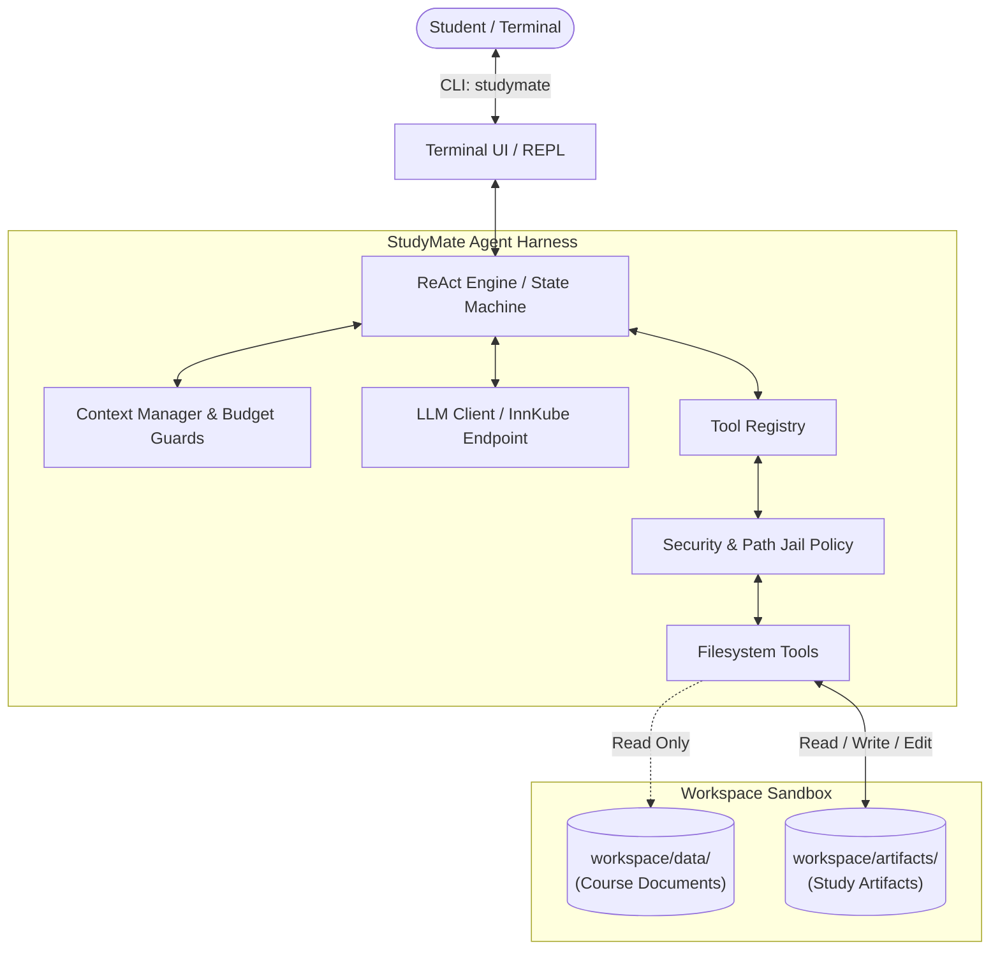

# StudyMate

StudyMate is an autonomous AI agent harness built from scratch in Python 3.12 for the *AI Engineering Lab (SoSe 2026)* at the University of Passau. It enables university students to prepare for courses and exams by autonomously analyzing source materials and generating structured study artifacts, including flashcards, mind maps, concept glossaries, and practice exercises.

---

## Overview and Features

StudyMate operates directly from the terminal via an interactive CLI (`studymate`). Built on the **ReAct (Reason + Act)** paradigm, it functions as an autonomous study assistant:

- **Source Material Analysis**: Inspects and synthesizes lecture slides, research papers, exercise sheets, and textbook notes stored in `workspace/data/`.
- **Study Artifact Generation**: Generates persistent study resources directly in `workspace/artifacts/`:
  - **Flashcards**: Markdown-formatted question-answer decks (compatible with Anki and Obsidian).
  - **Mind Maps**: Visual concept hierarchies and topic maps in standard Mermaid.js format.
  - **Glossaries and Key Concepts**: Structured term breakdowns and relationship explanations.
  - **Practice Exams and Quizzes**: Tailored question sets with reasoning explanations and solutions.
- **Strict Sandbox and Security Boundaries**:
  - `workspace/data/`: **Read-Only** (the immutable source of truth and knowledge base).
  - `workspace/artifacts/`: **Read, Write, and Edit** (where generated study artifacts reside).
  - **No Deletion Guarantee**: The agent is strictly prohibited from deleting any files or directories across all paths.
  - **Jail Containment**: All file operations are sandboxed strictly within `./workspace/`; directory traversal outside this boundary is rejected.

---

## Architecture



---

## Project Structure

```text
project/group-11/
├── config/
│   ├── config.yaml             # Model, agent parameters, and tool sandbox settings
│   └── soul.md                 # Agent persona, directives, and output conventions
├── src/
│   └── study_agent/
│       ├── cli/                # Terminal interactive REPL (studymate)
│       ├── config/             # Configuration schemas and YAML/env loader
│       ├── core/               # ReAct loop, context manager, and state machine
│       ├── llm/                # InnKube (OpenAI-compatible) client and test mocks
│       ├── tools/              # Tool registry and sandboxed filesystem tools
│       ├── memory/             # Persistent long-term memory (Week 2)
│       ├── observability/      # Prometheus telemetry & lifecycle hooks (Week 3)
│       ├── security/           # Multi-tier permission management (Week 3)
│       └── subagents/          # Specialized sub-agent coordination (Week 3)
├── tests/
│   ├── unit/                   # Unit tests (tools, parser, ReAct state transitions)
│   └── e2e/                    # End-to-end file and agent workflows
├── workspace/
│   ├── data/                   # Input study materials (Read-Only)
│   └── artifacts/              # Generated study artifacts (Read/Write/Edit)
├── Dockerfile                  # Container definition (python:3.12-slim-bookworm)
├── pyproject.toml              # Modern Python packaging & CLI entrypoint
└── requirements.txt            # Locked project dependencies
```

---

## Getting Started

### 1. Prerequisites
- Python 3.12+
- Docker (for containerized execution)

### 2. Local Setup
```bash
# Navigate to the project directory
cd project/group-11

# Create and activate a Python 3.12 virtual environment
python -m venv venv

# On Windows (PowerShell):
.\venv\Scripts\Activate.ps1

# On Linux/macOS:
source venv/bin/activate

# Install dependencies and install package in editable mode
pip install -r requirements.txt
pip install -e .
```

### 3. Environment Configuration
Create a `.env` file from the provided template and configure your InnKube API token:
```bash
cp .env.example .env
```

Edit `.env`:
```env
INNKUBE_API_KEY=your_innkube_token_here
```

### 4. Running StudyMate
Once installed, launch the interactive agent terminal using:
```bash
studymate
```

Alternatively, run as a Python module:
```bash
python -m study_agent
```

---

## Testing

Execute the automated test suite with pytest:
```bash
# Run all tests
pytest

# Run with test coverage
pytest --cov=study_agent
```

---

## Containerization (Docker)

To execute StudyMate inside an isolated Debian-based container (`python:3.12-slim-bookworm`):

```bash
# Build the container image
docker build -t studymate .

# Run the agent interactively with mounted workspace
docker run -it --rm \
  -e INNKUBE_API_KEY="your_api_key" \
  -v ./workspace:/app/workspace \
  studymate
```

---

## Roadmap and Milestones

- [x] **Week 1: Core ReAct Harness and Sandboxed File Tools**
  - Interactive terminal CLI (`studymate`)
  - YAML configuration with environment variable secret handling
  - Sandboxed file tools (create, read, modify, search; deletion prohibited)
  - Pytest unit & E2E suite; containerization
- [ ] **Week 2: Model Context Protocol (MCP) and Long-Term Memory**
  - Dynamic MCP client integration and runtime tool discovery
  - Custom non-trivial MCP tool extension
  - Persistent long-term memory across sessions
- [ ] **Week 3: Observability, Permissions, and Sub-Agents**
  - Prometheus metrics instrumentation and dashboard
  - Multi-tier permission system (`allow`, `deny`, `require-user-confirmation`)
  - Specialized sub-agents with task delegation on the same harness
