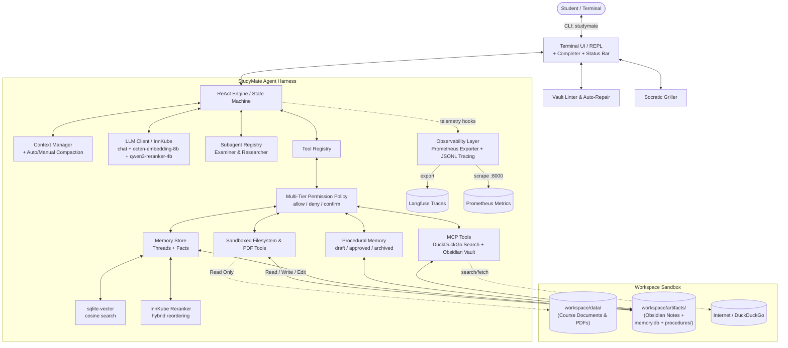

# StudyMate 
> **Study Agent & Obsidian Knowledge Graph Harness**  
> *AI Engineering Lab (SoSe 2026) — University of Passau (Group 11)*

StudyMate is an autonomous AI agent harness built from scratch in **Python 3.12**. It helps students master complex academic courses by transforming raw lecture slides, textbooks, and research papers into an atomic, interconnected **Obsidian knowledge base**, while providing active-recall Socratic sparring, persistent memory, subagent delegation, and production-grade observability.

---

##  Quick Start

Follow these simple steps to run and test StudyMate:

### 1. Installation & Environment Setup
```bash
# 1. Clone and navigate into the repository
git clone <repository-url>
cd group-11

# 2. Set up a Python 3.12 virtual environment
python -m venv .venv

# On Linux/macOS:
source .venv/bin/activate
# On Windows (PowerShell):
.\.venv\Scripts\Activate.ps1

# 3. Install runtime & development dependencies
pip install -r requirements.txt
pip install -e .

# 4. Configure your API token
cp .env.example .env
# Edit .env and set: INNKUBE_API_KEY="your_api_token"
```

### 2. Launch StudyMate Terminal
```bash
studymate
```

---

##  Feature-by-Feature Testing Guide

Here are quick prompts you can test in the `studymate` REPL to verify all capabilities:

| Feature to Test | Command / Input in REPL | What Happens |
| :--- | :--- | :--- |
| **1. Help & CLI Guide** | `/help` | Displays interactive slash commands, subagents, and memory controls. |
| **2. Active Settings** | `/config` | Displays model, context window, memory paths, and observability endpoints. |
| **3. Knowledge Ingestion** | `/ingest workspace/data` | Reads lecture materials (`.pdf`/`.txt`/`.md`) and generates linked Obsidian notes in `workspace/artifacts/`. |
| **4. Vault Linting & Repair** | `/lint` | Analyzes the knowledge graph for broken `[[wikilinks]]` or metadata errors and triggers automatic agent repairs. |
| **5. Socratic Grilling** | `/grill Backpropagation` | Spawns a 3-tier Socratic sparring session (Recall $\to$ Application $\to$ Edge Cases). |
| **6. Researcher Subagent** | `delegate to researcher for comparative analysis of FlashAttention vs MHA` | Spawns an isolated `researcher` subagent to perform multi-source research without cluttering main context. |
| **7. Examiner Subagent** | `use examiner to test me on Transformer architectures` | Spawns the read-only `examiner` subagent to quiz you without risking note corruption. |
| **8. Permission Gating** | `/permissions` | Displays active security policy rules (`allow`, `deny`, `require-user-confirmation`). |
| **9. Context Compaction** | `/compact` | Summarizes older conversation turns into a checkpoint when nearing context limits. |
| **10. Persistent Memory** | `/threads` | Opens the interactive arrow-key thread picker (`↑`/`↓` + Enter) to restore past chat sessions. |

---

##  3-Week Specification Completion Checklist

All requirements from Weeks 1, 2, and 3 have been fully implemented and verified with **261 unit & E2E benchmark tests**:

### Week 1: Core ReAct Harness, Sandboxed Tools & Study Vault Engine
- [x] **Autonomous ReAct Loop**: Custom Reason + Act state machine (`AgentEngine`) with step budgeting (`max_iterations`).
- [x] **Sandboxed Filesystem Tools**: 8 secure tools (`create_folder`, `write_file`, `read_file`, `read_pdf`, `list_files`, `search_text`, `edit_file`, `rename_file`).
- [x] **Path Jail & Security Containment**:
  - `workspace/data/` is strictly **Read-Only** (source materials).
  - `workspace/artifacts/` is **Read/Write/Edit** (generated knowledge base).
  - Directory traversal (`../`) and unauthorized path escapes are blocked.
  - **No-Delete Invariant**: Deletion is permanently prohibited across all storage layers.
- [x] **Obsidian Templates**: Standardized YAML frontmatter schemas and bidirectional `[[wikilinks]]` (`format_concept_note`).
- [x] **Knowledge Graph Linter**: `VaultLinter` detects broken links, missing frontmatter, and orphan notes.
- [x] **Socratic Griller**: `SocraticGriller` with German academic rigor across escalating difficulty levels.
- [x] **Interactive CLI**: Rich terminal REPL (`studymate`) with autocompletion and UTF-8 Windows compatibility.

### Week 2: Model Context Protocol (MCP) & Long-Term Memory
- [x] **MCP Web Research**: DuckDuckGo search integration (`web_search`, `fetch_web_content`, `expand_web_link`) via persistent stdio MCP bridge.
- [x] **MCP Obsidian Vault**: Dedicated FastMCP server (`obsidian_*`) exposing note inspection, backlinks, outgoing links, and anchored section inserts.
- [x] **Episodic Long-Term Memory**:
  - SQLite persistent chat threads (`workspace/artifacts/memory/memory.db`).
  - Semantic vector search with `sqlite-vector` Float32 cosine embeddings (`octen-embedding-8b`).
  - Cross-encoder reranker (`qwen3-reranker-4b`) for hybrid keyword + vector rank fusion.
  - Agent tools for memory storage and recall (`memory_store`, `memory_recall`).
- [x] **Procedural Memory Bundles**: Markdown routines in `workspace/artifacts/procedures/` with lifecycle stages (`draft`, `approved`, `archived`) and dynamic prompt injection.
- [x] **Context Window Compaction**: Proactive token estimation, gateway context window resolution, tool output pruning, and on-demand `/compact` checkpointing.

### Week 3: Observability, Multi-Tier Permissions & Subagents
- [x] **Prometheus Metrics Exporter**: Standalone HTTP exporter (`:8000/metrics`) tracking `studymate_agent_runs_total`, latency histograms, token counters, memory ops, tool calls, and subagent runs.
- [x] **Production Tracing & Langfuse**:
  - Harness-owned append-only JSONL log (`./observability/traces.jsonl`).
  - Asynchronous OpenTelemetry (OTel v4) export to self-hosted Langfuse.
  - Automatic dashboard widget provisioning (`provision-dashboard` service).
- [x] **Multi-Tier Security & Permission Gate**:
  - Configurable policy engine (`allow`, `deny`, `require-user-confirmation`).
  - Interactive terminal confirmation handler (`y` / `n` / `always`).
  - Fail-closed security for headless and non-interactive environments.
- [x] **Specialized Context-Isolated Subagents**:
  - `SubagentRegistry` & `DelegateTaskTool` for spawning isolated child `AgentEngine` instances.
  - Pre-configured `examiner` (read-only active recall) and `researcher` (deep literature analysis).
  - Correlated parent-child telemetry linking (`parent_run_id`).
- [x] **Background MCP Health Heartbeat**: Periodic 60s daemon probe recording `studymate_mcp_up` gauges and Langfuse heartbeat timelines.

---

##  System Architecture



---

## 🛠️ Tech Stack

- **Runtime**: Python 3.12 (`python:3.12-slim-bookworm` containerized)
- **Inference Engine**: InnKube OpenAI-compatible API (`qwen-agentworld-35b-a3b`, `gemma4-31b-it`)
- **Embeddings & Reranking**: `octen-embedding-8b`, `qwen3-reranker-4b`
- **Vector Search**: SQLite with `sqlite-vector` native extension
- **Tool Protocol**: Model Context Protocol (MCP) over Stdio (FastMCP + DuckDuckGo MCP Server)
- **Terminal UI**: `prompt_toolkit` + `rich` (formatted status bars, syntax highlighting, autocompletion)
- **Data Validation & Settings**: `pydantic>=2.7`, `pyyaml>=6.0`
- **PDF Extraction**: `pypdf>=4.0`
- **Observability**: `prometheus_client`, `langfuse>=2.0`, OpenTelemetry SDK
- **Testing**: `pytest`, `pytest-cov`, `pytest-mock`

---

## 💬 Interactive Commands & Triggers

StudyMate provides convenient slash commands and natural-language triggers in the REPL:

```text
StudyMate Commands:
  /help                  Show interactive help and available commands
  /ingest [path]         Ingest source materials and generate Obsidian notes
  /lint [path]           Run knowledge graph health check and auto-repair broken links
  /grill <topic>         Launch active-recall Socratic sparring session
  /templates             Display standard Obsidian markdown templates
  /threads               Browse previous chat threads (arrow keys ↑/↓ + Enter)
  /thread <id|name>      Switch to or continue a specific chat thread
  /new [name]            Start a fresh conversation thread
  /archive-this          Archive the active chat thread (soft tombstone)
  /archive-all           Archive all chat threads with confirmation
  /compact               Summarize history into a checkpoint immediately
  /clear                 Reset in-memory transcript (thread remains saved in SQLite)
  /config                Display current active configuration parameters
  /permissions           Show active tool permission policy and session allowances
  /exit, /quit           Exit StudyMate safely
```

### Natural-Language Delegation Triggers:
- **Researcher Subagent**: *"delegate to researcher for comparative analysis of X vs Y"*
- **Examiner Subagent**: *"use examiner to test me on topic Z"*

---

## 📂 Project Structure

```text
group-11/
├── config/
│   ├── config.yaml             # Source of truth: model, paths, tools, permissions, observability
│   └── soul.md                 # Agent persona, directives, and output formatting rules
├── src/
│   └── study_agent/
│       ├── cli/                # Terminal interactive REPL (studymate) with prompt_toolkit
│       ├── config/             # Pydantic schemas (settings.py) and YAML/env loader (loader.py)
│       ├── core/               # ReAct engine, context manager, compaction, subagent registry, types
│       ├── llm/                # OpenAI-compatible LLM client and offline test mocks
│       ├── memory/             # SQLite episodic store, sqlite-vector, reranking, and memory tools
│       ├── observability/      # Prometheus metrics, JSONL tracing, Langfuse export, health heartbeat
│       ├── security/           # Multi-tier permission policy engine and interactive confirmation
│       ├── study/              # Obsidian templates, VaultLinter, SocraticGriller, Procedures
│       └── tools/              # Tool registry, sandboxed filesystem/PDF tools, MCP adapters, delegation
├── observability/              # Prometheus scrape configuration and dashboard recording rules
├── scenarios/                  # Scenario walkthroughs and benchmark reports (Week 1, 2, 3)
├── tests/
│   ├── unit/                   # Unit tests (config, tools, context, memory, permissions, subagents, etc.)
│   └── e2e/                    # End-to-end benchmark tests (file ops, study workflows, MCP)
├── workspace/
│   ├── data/                   # Input study materials (Read-Only)
│   └── artifacts/              # Generated study notes, memory database, procedures (Read/Write)
├── compose.yaml                # Multi-service stack (StudyMate, Prometheus, Langfuse, Postgres, ClickHouse)
├── Dockerfile                  # Production container definition
├── pyproject.toml              # Packaging and CLI entrypoint definition
└── requirements.txt            # Locked runtime dependencies
```

---

##  Docker Deployment & Observability Stack

You can run StudyMate and its complete observability stack via Docker Compose:

```bash
# 1. Build the StudyMate container image
docker compose build studymate

# 2. Start the full observability backend (Prometheus, Langfuse, ClickHouse, Postgres)
docker compose up -d postgres redis clickhouse minio langfuse-web langfuse-worker prometheus provision-dashboard

# 3. Launch StudyMate in the container
docker compose run --rm --service-ports studymate
```

- **Prometheus Metrics**: `http://localhost:8000/metrics`
- **Langfuse Web UI**: `http://localhost:3000`

---

##  Automated Testing & Verification

StudyMate includes an extensive automated test suite covering all units, edge cases, and end-to-end workflows:

```bash
# Run the complete test suite
pytest -v
```

**Test Suite Result**: `261 passed, 3 skipped (100% pass rate)`.
