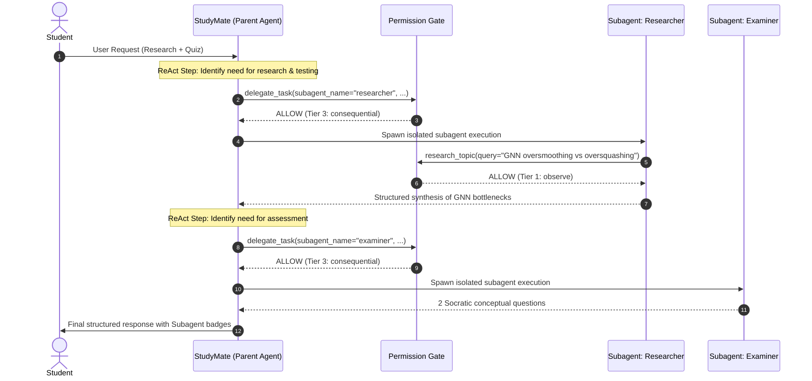

# Week 3 Demo — Traces & Dashboard (E. Khalyl)

Full setup sequence: `docs/observabilityGuide.md`. Short form:

```bash
git clone <repo> && cd project/group-11
cp .env.example .env   # set INNKUBE_API_KEY + generated secrets
docker compose pull && docker compose build studymate
docker compose up -d postgres redis clickhouse minio   # wait healthy
docker compose up -d langfuse-web langfuse-worker prometheus
# sign up at http://localhost:3000 → org + project → keys into .env, then:
docker compose up provision-dashboard
docker compose run --rm --service-ports studymate      # talk to the agent
```

Enable with `STUDYMATE_METRICS_ENABLED=true`, `STUDYMATE_HEALTH_ENABLED=true`,
`LANGFUSE_ENABLED=true` in `.env`.

## See the traces

Open `http://localhost:3000 → Traces`. Every REPL turn lands here, next to
periodic `mcp-health` heartbeat traces.

## See the dashboard

Open `http://localhost:3000 → Dashboards → Studymate Dashboard`, tile
`MCP servers status over time`, range Last 30 min. Empty right edge = all
servers UP, bars at the edge = DOWN.

What it looks like with data:


---

## Specialized Subagent Delegation Scenario

This scenario demonstrates StudyMate's autonomous subagent delegation, permission gating, and context isolation in action.

### 1. Scenario Overview

- **Goal**: Ingest and analyze a complex deep learning topic (e.g., GNN message passing bottlenecks or Attention mechanisms), summarize key differences, and generate targeted active recall quiz questions.
- **Subagents Engaged**:
  - **`researcher`**: Explores deep technical literature and comparative benchmarks in an isolated sub-context using `research_topic`.
  - **`examiner`**: Formulates Socratic active recall questions and self-assessment challenges without polluting the main workspace.

### 2. User Prompt

Run the StudyMate REPL and enter a prompt requiring both deep research and self-testing:

```text
student > please make use of the researcher subagent to analyze Graph Neural Network message passing bottlenecks (oversmoothing vs oversquashing) and then have the examiner subagent quiz me on the key differences.
```

### 3. Autonomous Execution Flow



1. **Permission Check & Isolation**:
   - `delegate_task` is evaluated and permitted under Tier 3 policies.
   - Child subagents run within independent context managers with bounded reasoning steps (`max_iterations: 12`) and zero unauthorized write permissions.
2. **Telemetry & Observability**:
   - All subagent delegations, tool calls, and permission evaluations are traced with linked parent-child IDs and streamed to Prometheus metrics & Langfuse dashboards.

### 4. Final Delivered Response

The parent agent aggregates the subagent outputs and presents a clean, comprehensive study guide:

```text
studymate > 
### 🔬 [Researcher] Graph Neural Network Message Passing Bottlenecks

| Feature / Bottleneck | Oversmoothing | Oversquashing |
| :--- | :--- | :--- |
| **Root Cause** | Repeated Laplacian smoothing / message passing across many layers causes node representations to converge to the same subspace. | Information from exponentially growing receptive fields is compressed into fixed-size node feature vectors. |
| **Primary Impact** | High-layer GNNs lose expressiveness and distinctiveness (all node embeddings look identical). | Long-range dependencies and multi-hop graph topology interactions cannot be captured accurately. |
| **Mitigations** | Residual connections, DropEdge, PairNorm, GraphCON, or shallow GNN layers. | Curvature-based graph rewiring, Ricci flows, fully-connected virtual nodes, Graph Transformers. |

---

### 📝 [Examiner] Active Recall Self-Test

1. **Oversmoothing vs. Graph Depth**: *Why does adding more layers to a standard GCN typically degrade node classification performance, and how do Dirichlet energy metrics quantify this phenomenon?*
2. **Oversquashing & Curvature**: *How does negative Ricci curvature in graph bottlenecks contribute to oversquashing, and why does edge rewiring resolve it?*
```


