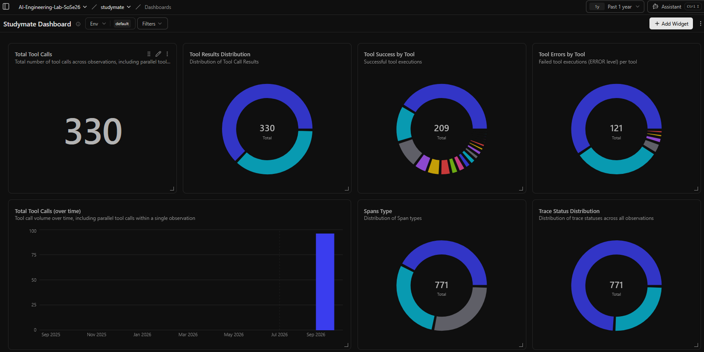
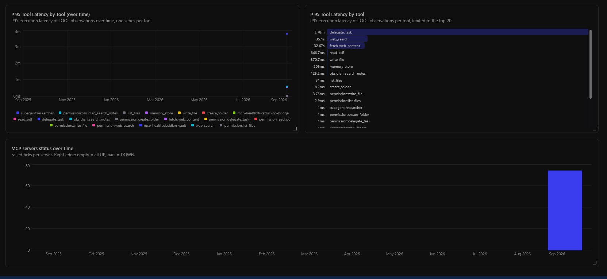
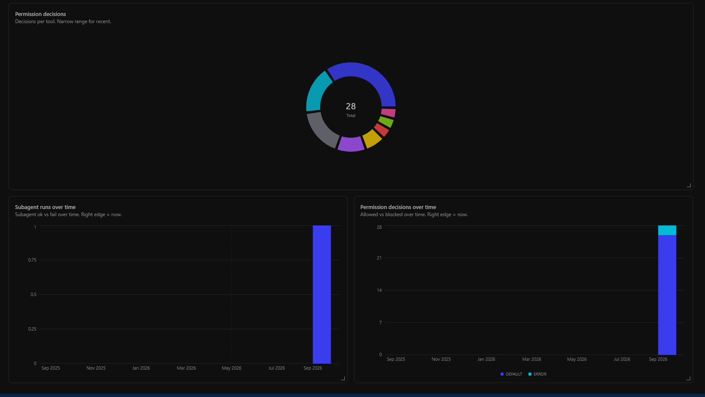

# Week 3 Demo — Traces & Dashboard (E. Khalyl)

Full setup sequence: `docs/observabilityGuide.md`. Short form:

```bash
git clone <repo> && cd project/group-11
cp .env.example .env   # set INNKUBE_API_KEY + generated secrets
docker compose pull && docker compose build studymate
docker compose up -d postgres redis clickhouse minio   # wait healthy
docker compose up -d langfuse-web langfuse-worker prometheus
# sign up at http://localhost:3000 → org + project → keys into .env, then:
docker compose up provision-dashboard
docker compose run --rm --service-ports studymate      # talk to the agent
```

Enable with `STUDYMATE_METRICS_ENABLED=true`, `STUDYMATE_HEALTH_ENABLED=true`,
`LANGFUSE_ENABLED=true` in `.env`.

## See the traces

Open `http://localhost:3000 → Traces`. Every REPL turn lands here, next to
periodic `mcp-health` heartbeat traces.

## See the dashboard

Open `http://localhost:3000 → Dashboards → Studymate Dashboard`, tile
`MCP servers status over time`, range Last 30 min. Empty right edge = all
servers UP, bars at the edge = DOWN.

What it looks like with data:







---

## Subagent Delegation, Permission Gating & Linked Traces

This walkthrough demonstrates StudyMate's specialized subagent delegation pattern under permission control, verifying context isolation and end-to-end observability linkage.

### 1. Scenario Overview

- **Student Query**: *"Can you run an in-depth comparative benchmark of FlashAttention vs. Standard Multi-Head Attention, focusing on memory complexity and GPU IO bottlenecks, and give me a quick quiz to test my understanding?"*
- **Why Delegation is Triggered**:
  - The request combines **deep technical research** (benchmarking, memory bounds, citation synthesis) and **active recall evaluation** (quizzing).
  - Instead of bloating the main conversation context with multi-step search scrapes or risking accidental note overwrites, the parent agent delegates to specialized child agents:
    1. **`researcher`**: Conducts topic exploration via `research_topic` in an isolated context window (capped at 12 iterations) with zero write permissions.
    2. **`examiner`**: Conducts active-recall question formulation with strictly read-only tools (`read_file`, `obsidian_get_backlinks`, `memory_recall`).

---

### 2. Execution Flow & Terminal Interaction

#### Step 1: Launch StudyMate REPL
```powershell
docker compose run --rm --service-ports studymate
```

#### Step 2: Student Input & Parent Autonomous Delegation
```text
student > Can you run an in-depth comparative benchmark of FlashAttention vs. Standard Multi-Head Attention, focusing on memory complexity and GPU IO bottlenecks, and give me a quick quiz to test my understanding?
```

**Parent ReAct Reasoning**:
- *Thought*: This query requires technical benchmarking across attention mechanisms followed by an active-recall check. I will first delegate the deep literature benchmark to the `researcher` subagent to avoid polluting the main context with raw benchmark data, and then delegate quiz formulation to the `examiner`.
- *Action*: Calls `delegate_task(subagent_name="researcher", task="Compare FlashAttention vs Standard MHA memory complexity and SRAM IO bottlenecks")`.

#### Step 3: Permission Policy Evaluation & Child Execution
- **Permission Gate**: The ToolRegistry evaluates the permission policy:
  - `delegate_task` is evaluated $\rightarrow$ **`ALLOW`** (tier: `sandbox-edit`).
  - Child's `research_topic` tool is evaluated $\rightarrow$ **`ALLOW`** (tier: `observe`).
  - Policy decisions are recorded in `studymate_permission_decisions_total{decision="allow",tool="delegate_task"}` and `studymate_permission_decisions_total{decision="allow",tool="research_topic"}`.
- **Context Isolation**: The child engine runs in an isolated `ContextManager`. Capped at 12 iterations, it produces a structured synthesis without accessing or modifying any vault files.

#### Step 4: Parent Observation Ingestion & Final Answer
- The condensed child synthesis is returned as the tool observation for `delegate_task`.
- The parent synthesizes the research results and invokes `delegate_task(subagent_name="examiner", task="Formulate 2 Socratic conceptual questions on FlashAttention tiling and SRAM vs HBM transfers")`.
- The parent delivers the final comprehensive study response to the student:

```text
studymate > 
### Comparative Technical Benchmark: FlashAttention vs. Standard MHA

| Property | Standard Multi-Head Attention | FlashAttention (Tiling + Recomputation) |
| :--- | :--- | :--- |
| **Memory Complexity** | $O(N^2)$ intermediate attention matrix in HBM | $O(N)$ memory footprint (tiled in fast SRAM) |
| **IO Bottleneck** | Memory-bandwidth bound (repeated HBM read/writes) | Compute-bound (kernel fusion reduces HBM roundtrips) |
| **Backward Pass** | Stores full $N \times N$ attention weights | Recomputes attention blocks on-the-fly in SRAM |

---

### Active Recall Check (from Examiner):
1. *Why does Standard Attention become memory-bandwidth bound on GPUs even when FLOPs are available?*
2. *How does online softmax scaling enable FlashAttention to compute exact attention in blocks without storing the entire $N \times N$ matrix?*
```

---

### 3. Verification of Observability & Linked Traces

#### A. Linked Traces in `observability/traces.jsonl`
Each child delegation generates a linked trace event where `parent_run_id` references the parent run:

```json
{
  "schema": 2,
  "status": "success",
  "run_id": "c9284f1a...",
  "parent_run_id": "a8193e2b...",
  "tools": [
    {
      "name": "subagent:researcher",
      "source": "mcp",
      "status": "ok",
      "duration_ms": 342.15
    }
  ],
  "iterations": 2,
  "duration_s": 0.342
}
```

Verify in PowerShell:
```powershell
Get-Content observability/traces.jsonl | ConvertFrom-Json | Select-Object run_id, parent_run_id, status, duration_s
```

#### B. Prometheus Metric Verification
Verify scraped metrics in Prometheus (`http://localhost:9092` or via API):

```powershell
# Check subagent run counters
(Invoke-RestMethod 'http://127.0.0.1:9092/api/v1/query?query=studymate_subagent_runs_total').data.result

# Check permission decisions
(Invoke-RestMethod 'http://127.0.0.1:9092/api/v1/query?query=studymate_permission_decisions_total').data.result
```

Expected series:
- `studymate_subagent_runs_total{config="researcher",status="success"} >= 1`
- `studymate_permission_decisions_total{decision="allow",tool="delegate_task"} >= 1`
- `studymate_permission_decisions_total{decision="allow",tool="research_topic"} >= 1`

#### C. Langfuse Dashboard
In **http://localhost:3000**:
1. Open **Traces**: Inspect the root parent run and view the nested `delegate_task` observation span and child generation details.
2. Open **Dashboards $\rightarrow$ Studymate Dashboard**:
   - `Subagent runs over time` widget reflects the `researcher` and `examiner` invocations.
   - `Permission decisions over time` widget displays the allowed decisions breakdown.

